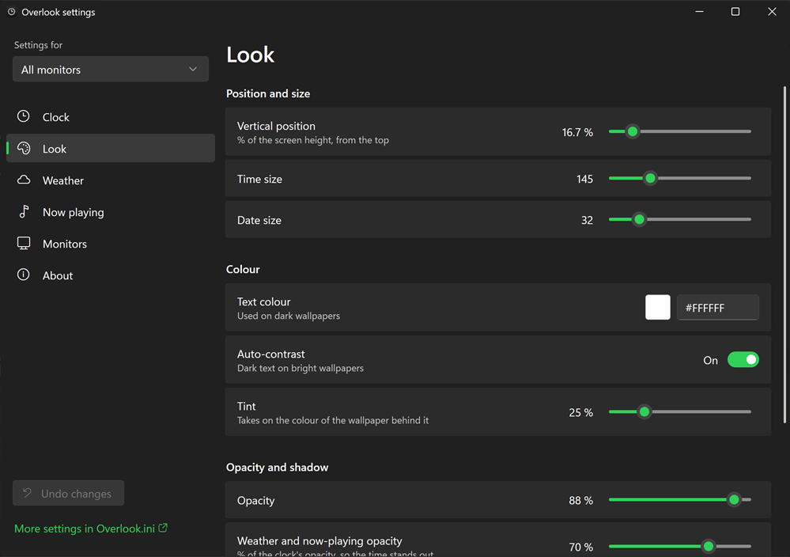

# Overlook

A clock for the Windows 11 desktop in the style of the macOS lock screen. It sits on your wallpaper, below the desktop icons and every window, and takes its colour from the wallpaper behind it.


Overlook is new. If you try it, please [tell me how it went](#feedback).

## Features

- **Lock-screen look**: the date over a large time, centred on each monitor.
- **Matches your wallpaper**: light or dark text chosen automatically, tinted toward the wallpaper's colour, and updated when the wallpaper or slideshow changes. On a busy wallpaper, such as bright sky through leaves, the shadow and the smaller lines get stronger so everything stays readable.
- **Smooth minute changes**: digits that stay slide into place and new ones fade in, at your display's refresh rate.
- **Weather**: temperature and high/low, plus extras only when they matter (feels-like, wind, rain, UV, air quality, sunrise or sunset). No account or API key.
- **Weather effects** (optional): soft clouds, fog, rain, sleet, thunderstorms and snow drift over the wallpaper, below the clock and icons, following the current weather and the wind. Windows animates them, so Overlook itself uses almost no CPU while they run, and they pause behind maximised or full-screen windows, on battery and in Energy Saver.
- **Now playing**: the artist and track from Spotify and other music apps, dimmed while paused.
- **Several monitors**: a clock on each, with its own settings, sharp at any display scaling.
- **OLED care**: an optional slow pixel shift and night dimming.
- **Update notices**: once a day it asks GitHub whether a newer release is out, and offers it in the tray menu and on the About page. It never downloads or installs anything by itself.
- **Light**: one small exe with no installer. Over an hour it averages about 0.2 s of CPU per minute (under 0.4% of one core) and sleeps in between. It hands its memory back after each minute change, so Task Manager usually shows under 2 MB. The animation runs in Windows' compositor, and the clock pauses while the screen is off or locked.

| The minute changes | The wallpaper changes |
|---|---|
|  |  |

**The weather through a day**: extras appear only when they matter (UV and air quality on a hot day, the hour rain is likely, wind and feels-like, the coming sunset, the moon's phase at night).


## Install

1. Download `Overlook.zip` from [Releases](../../releases) and unzip it to a folder you'll keep, e.g. `%LOCALAPPDATA%\Overlook`. What's new in each version: [CHANGELOG.md](CHANGELOG.md).
2. Run `Overlook.exe`. It isn't code-signed yet, so Windows SmartScreen may warn the first time: choose **More info**, then **Run anyway**.
3. To start it with Windows, tick **Start with Windows** in its tray menu.

Needs Windows 11 (x64). To remove it, choose **Exit** in the tray menu and delete the folder.

## Settings

Right-click the tray icon and choose **Settings…**. Every change shows on the clock straight away.



| Page | What you can change |
|---|---|
| **Clock** | 24-hour or 12-hour time with AM/PM, leading zero, date format and language (with a preview of today), Start with Windows |
| **Look** | Vertical position, time and date size, text colour, auto-contrast (dark text on bright wallpapers), tint, opacity, the weather and now-playing lines' opacity, shadow, adapting to busy wallpapers, the minute transition |
| **Weather** | The weather line on or off, your city, °C or °F, and the extras: chance of rain, feels like, wind, UV, air quality, sunrise and sunset. Weather effects: on or off, the real weather or one effect of your choice, opacity, lightning, running on battery or over Remote Desktop |
| **Now playing** | The now-playing line on or off, which apps it listens to, how long it stays after you pause |
| **Monitors** | Which monitors show a clock, OLED care (pixel shift, night dimming and its opacity) |
| **About** | Version, checking for updates (once a day, or now) a button to get the latest release and its SHA-256 to check the download, links to the source and issues, credits, and a diagnostic log for bug reports |

- **One monitor at a time:** pick a monitor under **Settings for** to give it its own values. A setting a monitor overrides gets a dot and a **Reset** link; under *All monitors* the window tells you which monitor keeps its own value.
- **Undo changes** puts everything back as it was when you opened the window.
- It follows Windows' light and dark mode and high contrast, works from the keyboard, and works with screen readers.

Everything is stored in `Overlook.ini` next to the exe (or in `%APPDATA%\Overlook` if that folder is read-only, such as under Program Files). The window edits it in place and keeps your comments. For the less common settings (gaps, letter spacing, shadow detail, thresholds, OpenType features), choose **Edit settings file…** in the tray menu; changes apply as soon as you save. Any setting can be different on one monitor:

```ini
[Monitor primary]
VerticalPosition=30
ShowWeather=0
```

Every setting is explained in the file itself and in [docs/DETAILS.md](docs/DETAILS.md).

## Feedback

Overlook has only been tested on a few setups so far, so reports from yours are very welcome:

- **Something looks wrong?** [Open an issue](../../issues/new) with a screenshot, your Windows version and your display scaling. For problems that come and go, turn on **Diagnostic log** under Settings › About and attach `Overlook.log`; place names, wallpaper names and track titles in it are masked.
- **Missing something?** Feature requests are welcome too, from small tweaks to new lines of information.
- **Want to help?** Pull requests are welcome. For bigger changes, open an issue first so we can agree on the approach.

## How it works

- It's a window inside the Windows desktop itself, between the wallpaper and the icons. So it never covers your apps, and it shows when you press Win+D.
- Text is drawn with Direct2D and DirectWrite, using the Inter typeface built into the exe. The minute animation runs in the Windows compositor, so the app does no work while it plays.
- The text colour comes from the part of the wallpaper behind the clock.
- Each line is centred by its visible outline rather than by font measurements. A built-in self-test checks every minute of the day and every date of a year.
- Weather comes from [Open-Meteo](https://open-meteo.com) every 30 minutes. Only your city name (once) and its coordinates are sent.
- The update check sends one anonymous request a day to GitHub's API (`api.github.com`), with a generic user agent and nothing about you or your PC. Turn it off on the About page.
- Weather effects are drawn once as soft shapes and animated by the Windows compositor, the same way as the minute change. They sit on the desktop layer under the clock, so they never cover your apps.
- Now playing listens to Windows' media controls, the same source as the volume flyout, with no polling.

More detail: [docs/DETAILS.md](docs/DETAILS.md).

## Build

Run `build.cmd`. It needs Visual Studio 2022 or later (any edition, or the Build Tools) with **Desktop development with C++**, and finds it by itself. The output is `bin\Overlook.exe`. GitHub Actions builds every push, runs `--ini-test`, `--update-test` and `--weather-test` (a failure fails the build; the reports are kept as the `selftest` artifact), and attaches a zip to each `v*` release.

## Credits and licence

- Code: MIT licence, see [LICENSE](LICENSE).
- [Inter](https://rsms.me/inter/) typeface by Rasmus Andersson, under the SIL Open Font License 1.1 ([fonts/OFL.txt](fonts/OFL.txt)).
- [Weather data by Open-Meteo.com](https://open-meteo.com/), licensed under [CC BY 4.0](https://creativecommons.org/licenses/by/4.0/). Their free API is for non-commercial use.
- Inspired by the macOS lock screen; not affiliated with Apple.
